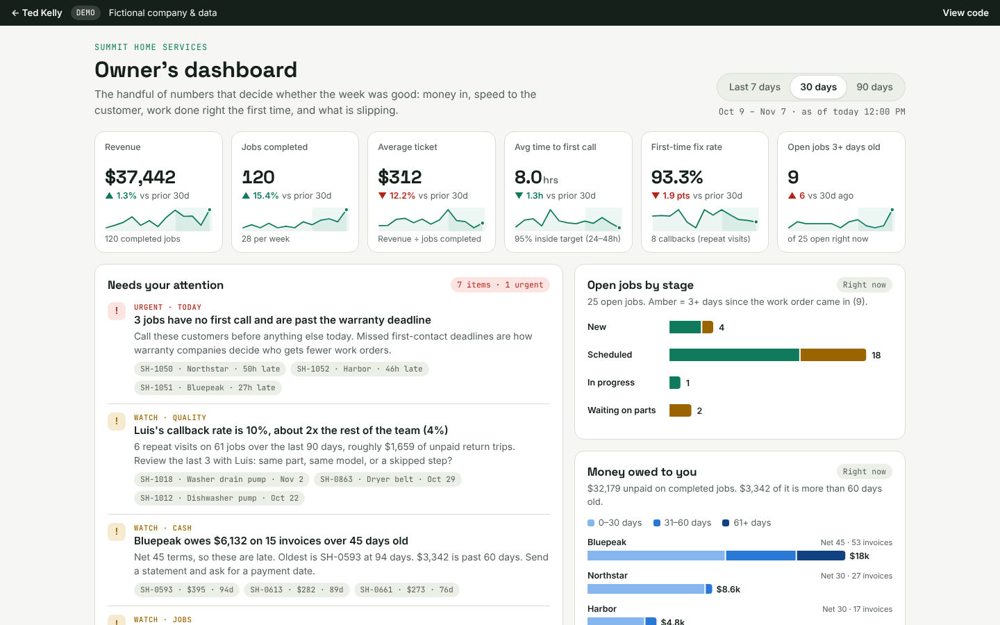

# Owner's KPI Dashboard

One page that tells a service-business owner how the business is doing and what to fix today.

**▶ [Live demo: tedkelly.dev/projects/kpi-dashboard](https://tedkelly.dev/projects/kpi-dashboard/)** · part of the [Service Business Toolkit](https://tedkelly.dev/projects/)



## The problem

Most owners of HVAC, plumbing and appliance repair shops run on gut feel. The job software holds the data,
but nobody pulls out the few numbers that matter:

- How much revenue each tech brings in, and their average ticket
- How fast customers get a first call (warranty companies track this, and send less work to slow shops)
- How many jobs are aging with no progress
- How many callbacks (repeat visits for the same problem) are eating profit
- Who owes you money, and how late it is

## What it shows

- **Period selector** (last 7 / 30 / 90 days). Every number on the page updates together.
- **Six KPI tiles**: revenue, jobs completed, average ticket, average time to first call (with % inside the
  warranty target), first-time fix rate, and open jobs 3+ days old. Each tile shows the change from the prior period,
  colored by whether that change is good or bad, plus a 13-week trend line.
- **Needs your attention**: a plain-English list built from the data. For example: jobs past the
  first-call deadline with no call yet, a tech whose callback rate is about twice the team's (with the jobs to review),
  a warranty company that is paying late, jobs stuck waiting on parts, and new jobs with no tech assigned.
- **Charts**: revenue by trade over time, revenue per tech, time to first call against each sender's deadline,
  open jobs by stage, and unpaid invoices by sender and age (0–30, 31–60, 61+ days).
- **Tech leaderboard**: jobs, revenue, average ticket, average first-call time and callback rate per tech.

## Try it

**https://tedkelly.dev/projects/kpi-dashboard/**

Switch the period at the top right. Hover or tab onto any bar for its numbers. The revenue-by-trade and receivables
charts also have a "Show as table" view.

## Built with

- Plain HTML, CSS and JavaScript. No framework, no build step, no chart library.
- Charts are hand-drawn inline SVG, so they stay sharp and follow light and dark mode.
- Shared demo data and styles from [`shared`](shared).
- Runs entirely in the browser on GitHub Pages.

For developers: all logic is in `app.js`. It merges the open jobs and recent history from `window.SUMMIT` with a
simulated history (seeded PRNG, so it is identical on every load). It also simulates payment dates from each sender's
pay terms. Then it computes every tile, chart, table and attention item from that one job list, so the numbers always
agree. `window.__KPI` exposes the computed data for poking around in devtools.

## About the data

Summit Home Services is a **fictional company**. Every name, claim number and dollar amount is made up.
The open jobs and the last few weeks of history come from the shared demo data. The older history (about 26 weeks)
and all payment dates are **simulated** so the trends have something to show.

## Run it locally

No install or build step. Clone the repo and open `index.html` in a browser, or serve the folder:

```bash
git clone https://github.com/TedKelly561/kpi-dashboard.git
cd kpi-dashboard
python3 -m http.server 8000   # then open http://localhost:8000
```

`shared/data.js` holds the fictional company (Summit Home Services) shared by every demo in the toolkit.

## More from the toolkit

- [Work Order Intake](https://github.com/TedKelly561/work-order-intake): messy email → clean service ticket
- [Quote Builder](https://github.com/TedKelly561/quote-builder): price-book quotes with margin view and approve links
- [Dispatch Board](https://github.com/TedKelly561/dispatch-board): drag-and-drop dispatch with first-call deadline alerts
- [Owner's KPI Dashboard](https://github.com/TedKelly561/kpi-dashboard): the numbers that run a service business

## About

Built by **Ted Kelly**, who runs a service business and builds the software behind it. Want something like this for your business? Visit **[tedkelly.dev](https://tedkelly.dev)**.

## License

[MIT](LICENSE). All companies, people, addresses and claim numbers in this demo are fictional.
